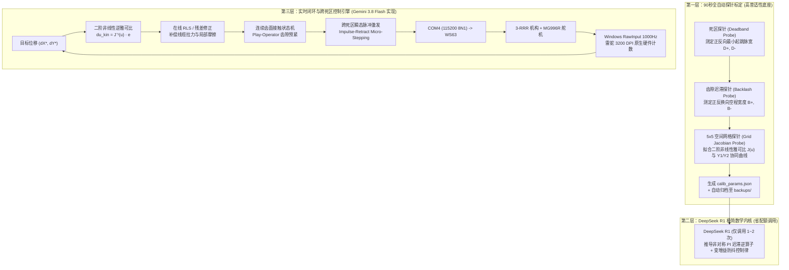

# PROJECT_PLAN.md — 3-RRR 平面并联机构 3200 DPI 普适性精密定位系统执行总纲

> **核心目标**：在机械装配已达物理极限的前提下，通过**“物理二阶非线性雅可比 + 连续齿隙迟滞状态机 + 跨死区瞬态脉冲激发（Impulse-Retract）+ 轻量级在线残差学习”**四层架构，突破 MG996R 舵机的死区与齿隙极限，实现 **90 秒全自动标定（高普适性）** 与 **3200 DPI（$7.9\ \mu\text{m}/\text{count}$）微米级闭环定位**。

---

## 一、 系统架构全景图

---

## 二、 为什么这套方案能突破 MG996R 舵机极限且极具普适性？

| 传统“纯 AI 暴力收集调参”痛点 | 本方案（物理引导 + 状态机 + 瞬态脉冲微步）解决方案 |
| :--- | :--- |
| **样本黑洞**：需采集数万点才能拟合三角几何关系，耗时数小时 | **物理先验降维**：用二阶多项式雅可比 + 齿隙状态机，仅需 **14 个物理参数**，**90 秒自动标定完毕** |
| **零普适性**：换鼠标垫、重贴胶带或微调拉杆后模型完全失效 | **一键重标定**：任何机械变动后运行 `python hardware_probe.py`，1.5 分钟内重新生成精准模型 |
| **死区卡死**：误差 $< 3\text{ px}$ 时对应脉宽 $< 5\ \mu\text{s}$，舵机内部比较器不动作 | **跨死区瞬态脉冲激发（Impulse-Retract）**：发送 1 帧（20ms）跨死区前冲脉冲破除静摩擦，下一帧立即回撤至目标微步 |
| **换向抽搐**：简单 `+45/-45 us` 硬跳变在零点附近引发高频极限环震荡 | **连续齿面接触状态机（Play-Operator）**：实时追踪齿轮在齿隙 `[ -B⁻, +B⁺ ]` 内的真实物理位置，平滑过渡无抖动 |

---

## 三、 Gemini 3.8 Flash 与 DeepSeek R1 详细分工与执行步骤

> **铁律**：每完成以下任何一个步骤（Step 1 ~ Step 6），执行者必须运行 `.\scripts\git_sync.ps1` 将代码与标定数据同步至 GitHub！

---

### 阶段一：防丢码基础设施与双端代码入库（Step 1）
- **负责模型**：`Gemini 3.8 Flash`
- **执行内容**：
  1. 初始化本地 Git 仓库，建立 `.gitignore`、`AGENTS.md`（Agent 行为约束）与 `scripts/git_sync.ps1`（自动备份与 GitHub 推送脚本）。
  2. 将 `D:\ws63\src\application\samples\custom\servo_test.c` 及备份文件同步拷贝至本仓库 `firmware_ws63/` 目录，实现**上位机 + 下位机固件同仓保护**。
  3. 编写核心模块脚手架：
     - [`mouse_sensor.py`](file:///c:/Users/27798/Desktop/3-rrr/mouse_sensor.py)：基于 Windows `WM_INPUT` RawInput 的 3200 DPI 原生硬件计数采集器（绕过系统指针加速与屏幕边界限制）。
     - [`servo_driver.py`](file:///c:/Users/27798/Desktop/3-rrr/servo_driver.py)：包含 CH340 端口自动发现、安全限幅、平滑插补、连续齿隙状态机与瞬态脉冲激发（Kinetic Nudge）的驱动层。
     - [`hardware_probe.py`](file:///c:/Users/27798/Desktop/3-rrr/hardware_probe.py)：90 秒全自动死区/齿隙/空间网格雅可比标定器。
     - [`closed_loop_controller.py`](file:///c:/Users/27798/Desktop/3-rrr/closed_loop_controller.py)：3200 DPI 实时闭环控制与在线 RLS 自适应残差定位引擎。
- **准出检查点（Git Checkpoint 1）**：
  - 运行 `.\scripts\git_sync.ps1 "init: 搭建双端防丢码仓库、Agent规范与四层控制核心模块"`。

---

### 阶段二：传感器与串口通信基准验证（Step 2）
- **负责模型**：`Gemini 3.8 Flash`
- **执行内容**：
  1. 在终端运行 `E:\anaconda\envs\pytorch\python.exe mouse_sensor.py`，验证 Windows RawInput 1000Hz 原生计数正常输出。
  2. 运行 `E:\anaconda\envs\pytorch\python.exe servo_driver.py`，验证 `COM4` 正常握手、舵机平稳归中至 `(1510, 1545, 1455, 1500)` 且无异常抖动。
- **准出检查点（Git Checkpoint 2）**：
  - 运行 `.\scripts\git_sync.ps1 "test: 完成COM4串口握手与3200DPI RawInput传感验证"`。

---

### 阶段三：90 秒全自动硬件极限探针采集（Step 3）
- **负责模型**：`Gemini 3.8 Flash`
- **执行内容**：
  1. 运行 `E:\anaconda\envs\pytorch\python.exe hardware_probe.py`。
  2. 脚本自动执行三项物理极限探测：
     - **实验 A（死区探测）**：测定 $S_1 (X)$ 与 $S_2/S_3 (Y)$ 刚能引起鼠标产生 $\ge 2\text{ counts}$ 位移的最小脉冲增量 $D^+, D^-$；
     - **实验 B（正反齿隙探测）**：先单向运动使齿面完全贴合，再反向微步递增，测定换向空程 $B_x^+, B_x^-, B_y^+, B_y^-$；
     - **实验 C（空间非线性雅可比网格探测）**：在安全工作区内采集 $3\times 3$（或 $5\times 5$）网格点局部偏导数 $\frac{\partial (X,Y)}{\partial (u_x, u_y)}$，拟合成二阶多项式雅可比模型。
  3. 自动保存 `calib_params.json`，并自动生成专供 DeepSeek R1 使用的高密度数学 Prompt 文件 `prompts/deepseek_r1_stage1.md`。
- **准出检查点（Git Checkpoint 3）**：
  - 运行 `.\scripts\git_sync.ps1 "calib: 完成MG996R死区、齿隙与空间雅可比自动探针采集"`。

---

### 阶段四：DeepSeek R1 极限控制律数学推导（Step 4 —— 唯一核心 R1 调用点）
- **负责模型**：`DeepSeek R1`（仅调用 **1 次**，严控配额消耗）
- **执行内容**：
  1. 将 `prompts/deepseek_r1_stage1.md` 中的实测物理参数输入给 **DeepSeek R1**。
  2. 由 **DeepSeek R1** 一次性推导并输出：
     - 非对称 Prandtl-Ishlinskii 连续齿隙逆补偿算子参数；
     - 跨死区瞬态脉冲（Impulse-Retract）最优激发幅值 $u_{\text{kick}}$ 与保持帧数公式；
     - 避免在目标点 $\pm 2\text{ counts}$ 内发生极限环震荡的**死区自适应变增益 PI + 在线 RLS 更新律**。
  3. 将 DeepSeek R1 的推导结果保存至 `docs/deepseek_r1_derivation.md`。
- **准出检查点（Git Checkpoint 4）**：
  - 运行 `.\scripts\git_sync.ps1 "docs(math): 归档DeepSeek-R1非对称齿隙与跨死区控制律推导"`。

---

### 阶段五：算法合入、在线残差微调与 3200 DPI 闭环打靶验证（Step 5）
- **负责模型**：`Gemini 3.8 Flash`
- **执行内容**：
  1. `Gemini 3.8 Flash` 将 DeepSeek R1 推导的控制律参数合入 `closed_loop_controller.py`（必要时同步升级 `firmware_ws63/servo_test.c` 的硬件级脉冲激发指令）。
  2. 运行闭环打靶基准测试（`python closed_loop_controller.py --mode benchmark`）：
     - **测试 1**：四象限阶跃定位测试（$\pm 50\text{ counts}, \pm 150\text{ counts}, \pm 300\text{ counts}$）；
     - **测试 2**：微米级极小步进测试（$1\sim 5\text{ counts}$ 点动定位，检验跨死区脉冲激发效果）；
     - **测试 3**：连续圆轨迹与矩形轨迹跟踪测试，开启在线 RLS 残差自适应，输出定位误差统计报表（RMSE、最大超调量、稳态误差 Counts）与可视化曲线。
- **准出检查点（Git Checkpoint 5）**：
  - 运行 `.\scripts\git_sync.ps1 "feat(control): 完成3200DPI闭环控制律合入与实机打靶验证"`。
