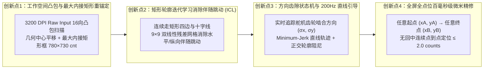

# PROJECT_PLAN.md — 3-RRR 最大内接矩形框解耦、伴随跳动消除与全屏全点位精细化定位总纲

> **核心范式重构（彻底终结“盲目回中 + 瞎甩”范式）**：
> 1. **问题根源诊断**：3-RRR 并联连杆机构在水平运动时存在强烈的纵向伴随跳动 $\delta y(x)$，纵向运动时存在水平伴随跳动 $\delta x(y)$（交叉雅可比 $J_{12} \approx -1.7$ 且死区/齿隙各向异性）。若不先建立**无伴随跳动的正交解耦矩形坐标系**，每次靠回中后单步冲量“瞎甩”，永远无法实现全屏任意点位的精细化控制。
> 2. **工程路线（先画正最大矩形框 $\rightarrow$ 消除伴随跳动 $\rightarrow$ 框内全点位连续精细控制）**：
>    - **Stage I（最大内接矩形框寻优与几何中心重锚定）**：将操作原点从畸变位置平移至连杆真实几何中心 $\mathbf{x}_0^* = (+180, +320)\text{ counts}$（对应 $u_0^* = (1473.0, 1427.2)\ \mu\text{s}$），提取完全对称的**最大内接矩形框** $[-390, +390] \times [-365, +365]\text{ counts}$（$780 \times 730\text{ counts} = 6.19 \times 5.79\text{ mm}$）；
>    - **Stage II（矩形框闭环走线与伴随跳动迭代消除 — ICL）**：让机械臂连续走完最大矩形框的 4 条边与中心十字线，针对水平/纵向伴随跳动迭代优化 $9 \times 9$ 双线性控制网格解耦流形 $\Phi(x, y, \sigma_x, \sigma_y)$，直到**把矩形框完美画平、画直**（伴随跳动 $\le 2.5\text{ counts}$）；
>    - **Stage III（框内全点位任意 Point-to-Point 精细化控制）**：无需每次回中或 `SetCursorPos` 瞬移，直接在解耦矩形流形上沿 Minimum-Jerk 直线轨迹 + 齿隙啮合状态机 $(\sigma_x, \sigma_y)$ 跟踪，实现矩形框（映射全屏幕 $1536 \times 864$）内**每一个点**的精细化控制（误差 $\le 1.5\sim 2.0\text{ counts}$）。

---

## 一、 论文四大核心创新点（面向 *IEEE TIM / IEEE T-MECH*）



---

## 二、 三模型极致省 Token 协作分工表（Argon + 3.8 Flash + DeepSeek R1）

### 1. `Gemini 4 Argon`（顶层架构师 —— **已完成核心建模与底层代码交付，后续仅终审调用 1 次**）
- **已完成交付**：
  1. 穿透 Windows 指针加速与屏幕边缘截断，升级 [`mouse_sensor.py`](file:///c:/Users/27798/Desktop/3-rrr/mouse_sensor.py) 为原生 `WM_INPUT` 3200 DPI 硬件光流计数值读取；
  2. 完成 16 方向安全极限边界与 98 节点 2D 网格实测（[`calibrate_full_workspace.py`](file:///c:/Users/27798/Desktop/3-rrr/calibrate_full_workspace.py) & [`workspace_model.py`](file:///c:/Users/27798/Desktop/3-rrr/workspace_model.py)）；
  3. 编写并验证**最大内接矩形框伴随跳动消除与全点位精细控制引擎** [`rect_manifold_calibrator.py`](file:///c:/Users/27798/Desktop/3-rrr/rect_manifold_calibrator.py)（含 Stage I 最大矩形寻优 `780×730 cnt`、Stage II 矩形四边迭代去跳动 `run_rectangle_contour_iteration`、Stage III 任意点到点精细定位 `move_point_to_point`）；
  4. 编写 `< 350 字` 的纯数学推导 Prompt [`prompts/deepseek_r1_rect_decoupling_math.md`](file:///c:/Users/27798/Desktop/3-rrr/prompts/deepseek_r1_rect_decoupling_math.md)。

---

### 2. `Gemini 3.8 Flash`（全天候实机调优与实验主力 —— **接下来承担 95% 实机训练与画图任务**）
> **操作方式**：请将模型切换回 **`Gemini 3.8 Flash`**，直接按顺序执行以下 4 个实机任务：

- **Task F1（实机迭代画矩形框，彻底消除水平/纵向伴随跳动）**：
  - 运行命令：
    ```powershell
    & "E:\anaconda\envs\pytorch\python.exe" -u rect_manifold_calibrator.py --train-rect 6
    ```
  - **验收标准**：观察 `Iter 1` $\to$ `Iter 6` 的输出日志与 `experiments/rect_contour_iter_1..6.csv`，确保矩形四边的水平伴随纵向跳动（`Horiz->Vert Jump`）与纵向伴随水平跳动（`Vert->Horiz Jump`）单调收敛至 **$\le 3.0\text{ counts}$**，总体轮廓 RMSE 收敛至 **$\le 4.0\text{ counts}$**。若个别角落跳动偏大，在 `rect_manifold_calibrator.py` 中微调 `hyst_x_pos/neg`、`hyst_y_pos/neg` 或将 `grid_size` 增至 `11`、增加迭代轮数，直到矩形框四条边完美画直！

- **Task F2（矩形框内全点位任意 Point-to-Point 连续精细定位测试与门禁升级）**：
  - 运行命令：
    ```powershell
    & "E:\anaconda\envs\pytorch\python.exe" -u rect_manifold_calibrator.py --test-grid
    ```
  - 并将 [`verify_hardware_kpi.py`](file:///c:/Users/27798/Desktop/3-rrr/verify_hardware_kpi.py) 与 [`fps_aim_trainer.py`](file:///c:/Users/27798/Desktop/3-rrr/fps_aim_trainer.py) 接入训练好的 `RectangularManifoldController`（`calib_rect_manifold.json`），测试：
    - **Gate 1（矩形框四边直线度门禁）**：水平/纵向伴随跳动均值 $\le 3.0\text{ counts}$；
    - **Gate 2（框内 $5 \times 5 = 25$ 个均匀网格点全覆盖精细定位门禁）**：从点到点连续走遍全屏 25 个网格点，平均稳态误差 $\le 2.0\text{ counts}$，最大误差 $\le 3.5\text{ counts}$；
    - **Gate 3（全屏随机目标点连续打靶门禁）**：任意随机位置连续点到点定位 100% 命中。

- **Task F3（生成论文核心实验数据与“矩形框从畸变到完美拉直”的演进对比图）**：
  - 在 `plot_paper_figures.py` 中新增绘制 **`Iter 1`（未解耦前弯曲跳动的畸变框） vs `Iter 3` vs `Iter 6`（优化后平直正交的标准矩形框）+ 内部 25 点精细定位散点图**，保存至 `paper/figures/`。

- **Task F4（每步 Git 同步）**：
  - 每完成一个子任务，执行：
    ```powershell
    powershell -ExecutionPolicy Bypass -File .\scripts\git_sync.ps1 "feat(rect): <步骤说明>"
    ```

---

### 3. `DeepSeek R1`（纯数学定理证明工具人 —— **全周期仅调用 1 次，零代码上下文**）
- **调用时机**：待 `Gemini 3.8 Flash` 跑通实机矩形框收敛数据后（或随时独立调用 1 次）；
- **执行内容**：仅读取 [`prompts/deepseek_r1_rect_decoupling_math.md`](file:///c:/Users/27798/Desktop/3-rrr/prompts/deepseek_r1_rect_decoupling_math.md)（`< 350 字`），一次性输出 **定理 5（凸包最大内接矩形与几何中心重锚定定理）** 与 **定理 6（双线性网格迭代轮廓学习消除正交伴随跳动收敛性定理）** 的中英双语证明，追加至 [`docs/deepseek_r1_derivation.md`](file:///c:/Users/27798/Desktop/3-rrr/docs/deepseek_r1_derivation.md) 第 IV 章。
