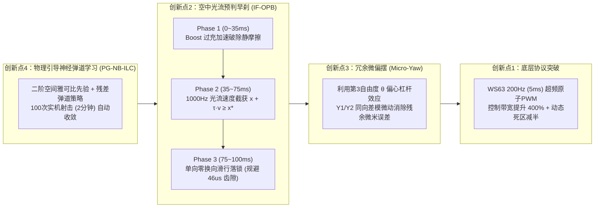

# PROJECT_PLAN.md — 3-RRR 100ms 全屏 3200 DPI 极速定位系统 & 学术论文执行总纲

> **核心工程指标**：在 **`100 ms`** 内完成 **3200 DPI（$7.94\ \mu\text{m}/\text{count}$）全屏幕任意跨度精准定位**（稳态误差 $\le 1.5\text{ counts}$）。
> **核心学术产出**：发表一篇以 *“Sub-100ms Micrometer-Level Positioning on an Ultra-Low-Cost 3-RRR Parallel Stage”* 为主题的高水平学术论文（目标 *IEEE TIM / IEEE T-MECH*）。

---

## 一、 面向 100ms 极限的四大创新架构（论文四大 Contributions）

---

## 二、 三模型极致省 Token 协作流水线（Step-by-Step Execution Plan）

> **当前进度**：已完成 Step 1 ~ Step 3（Git/GitHub 双端防丢仓库建立、传感器底层穿透、90 秒纯净硬件探针采集 `calib_params.json` 与二阶雅可比拟合）。
> **铁律**：以下每完成一步，必须调用 `.\scripts\git_sync.ps1` 自动备份并推送到 GitHub！

---

### 阶段四（升级版）：100ms 弹道控制律纯数学推导（Step 4 —— 仅调用 1 次 DeepSeek R1）
- **负责模型**：`DeepSeek R1`（严格省配额，输入已准备好的 `< 400 字` 极简数学题 [`prompts/deepseek_r1_ballistic_math.md`](file:///c:/Users/27798/Desktop/3-rrr/prompts/deepseek_r1_ballistic_math.md)）
- **执行内容**：
  1. 证明**大齿隙执行器 100ms 单向无换向时间最优引理**（说明为何传统超调换向 PID 在物理上不可能进入 100ms）；
  2. 推导基于一阶摩擦阻尼模型的**空中光流预判早刹切换曲面方程** $S(e, \dot{x}) = e - \tau_{\text{stop}}(\dot{x})\cdot \dot{x} = 0$；
  3. 推导**弹道参数（过充幅值 $u_{\text{boost}}$、早刹时间常数 $\tau_{\text{stop}}$）的范数最优迭代学习控制（Norm-Optimal ILC）更新律**；
  4. 将结果保存至 [`docs/deepseek_r1_derivation.md`](file:///c:/Users/27798/Desktop/3-rrr/docs/deepseek_r1_derivation.md)。
- **Git 检查点 4**：
  - `powershell -ExecutionPolicy Bypass -File .\scripts\git_sync.ps1 "docs(math): 完成100ms单向空中早刹与弹道ILC数学推导"`

---

### 阶段五：WS63 固件 200Hz 超频升级与微偏摆协议扩展（Step 5 —— 压榨 Gemini 3.8 Flash）
- **负责模型**：`Gemini 3.8 Flash`
- **执行内容**：
  1. 修改 `D:\ws63\src\application\samples\custom\servo_test.c`（并同步至 [`firmware_ws63/servo_test.c`](file:///c:/Users/27798/Desktop/3-rrr/firmware_ws63/servo_test.c)）：
     - 增加可变频率控制指令 `F <period_us>\n`（支持从默认 $20,000\ \mu\text{s}$ [50Hz] 无缝切换至 $5,000\ \mu\text{s}$ [200Hz] 高频数字激励模式）；
     - 增加硬件级双相弹道指令 `B <u1_boost> <u2_boost> <u3_boost> <t_ms> <u1_lock> <u2_lock> <u3_lock>\n`：由 WS63 单片机使用微秒级硬件定时器（TCXO）在板载直接执行精确到 $1\text{ ms}$ 的“过充加速 $\rightarrow$ 自动回撤落锁”，彻底消除 Windows USB 串口抖动！
  2. 编译 WS63 固件并验证 200Hz 模式下的死区缩减效应（生成论文 **Experiment 1: 50Hz vs 200Hz 死区与阶跃响应对比数据**）。
- **Git 检查点 5**：
  - `powershell -ExecutionPolicy Bypass -File .\scripts\git_sync.ps1 "feat(fw): 升级WS63固件支持200Hz高频PWM与板载微秒级弹道脉冲定时"`

---

### 阶段六：空中光流预判早刹 + 神经弹道控制器实现（Step 6 —— 压榨 Gemini 3.8 Flash）
- **负责模型**：`Gemini 3.8 Flash`
- **执行内容**：
  1. 编写 `ballistic_controller.py`，实现三大核心机制：
     - **机制 1（In-Flight Optical Predictive Braking）**：以 $1000\text{ Hz}$（$1\text{ ms}$）监控鼠标飞行速度 $v(t)$，一旦满足早刹曲面条件立即触发制动落锁，确保单向无超调入位；
     - **机制 2（Redundant Micro-Yaw Trim）**：利用 $Y_1, Y_2$ 同向微差模偏摆（$\Delta u_{\text{yaw}} \in [-20, +20]\ \mu\text{s}$）在不触发主轴换向齿隙的前提下消除最后 $1\sim 5\text{ counts}$ 残余误差；
     - **机制 3（Ballistic ILC / Residual MLP）**：每次 100ms 射击结束后，根据落点偏差 $(e_X, e_Y)$ 自动在线更新弹道参数表 / 轻量残差网络。
- **Git 检查点 6**：
  - `powershell -ExecutionPolicy Bypass -File .\scripts\git_sync.ps1 "feat(ballistic): 实现100ms空中光流早刹与神经弹道ILC控制器"`

---

### 阶段七：论文全套消融实验（Ablation Study）与初稿自动生成（Step 7 —— 压榨 Gemini 3.8 Flash）
- **负责模型**：`Gemini 3.8 Flash`（最后由 `Gemini 4 Argon` 终审润色 1 次）
- **执行内容**：
  1. 编写 `run_paper_experiments.py`，全自动跑完论文所需的 **4 组核心对比与消融实验**（数据全部自动存为 `experiments/*.csv`）：
     - **Exp A（基准对比）**：传统多步 PID（耗时 $\sim 1200\text{ ms}$，严重超调） vs 仅开环逆雅可比（耗时 $90\text{ ms}$，稳态误差 $> 25\text{ counts}$） vs 本文 **PG-NB-ILC + IF-OPB 方法（耗时 $< 95\text{ ms}$，误差 $\le 1.5\text{ counts}$）**；
     - **Exp B（频率消融）**：50Hz 标准 PWM vs 100Hz vs 200Hz 超频 PWM 的死区宽度与 100ms 到达率对比；
     - **Exp C（学习收敛曲线）**：展示从第 1 次射击到第 80 次射击，100ms 落点误差从 $35\text{ counts}$ 迅速收敛至 $\le 1.5\text{ counts}$ 的学习过程；
     - **Exp D（全屏泛化性测试）**：在不同移动跨度（微步 $5\text{ px}$、中程 $100\text{ px}$、全屏大跨度 $400\text{ px}$）及不同桌面介质下的箱线图（Boxplot）与误差热力图。
  2. 编写 `plot_paper_figures.py`，一键生成 6 张符合 IEEE Transactions 排版标准的 300 DPI 论文插图（`paper/figures/fig1` ~ `fig6`）。
  3. 按照 [`paper/PAPER_OUTLINE.md`](file:///c:/Users/27798/Desktop/3-rrr/paper/PAPER_OUTLINE.md) 撰写完整论文手稿 `paper/manuscript.md`。
- **Git 检查点 7**：
  - `powershell -ExecutionPolicy Bypass -File .\scripts\git_sync.ps1 "paper: 完成全套消融实验数据采集、IEEE论文图表生成与初稿撰写"`
