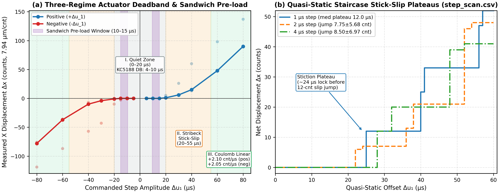
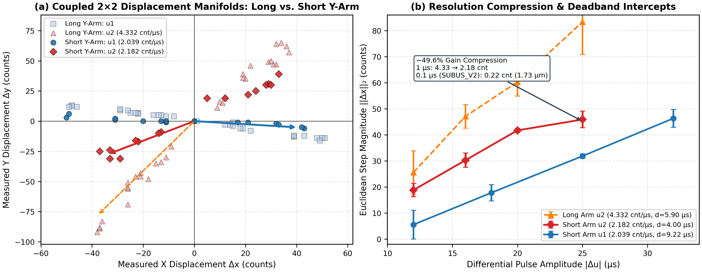
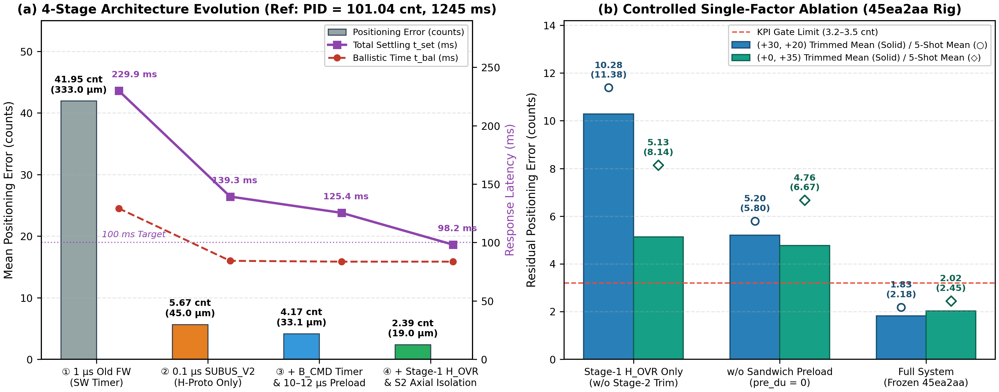
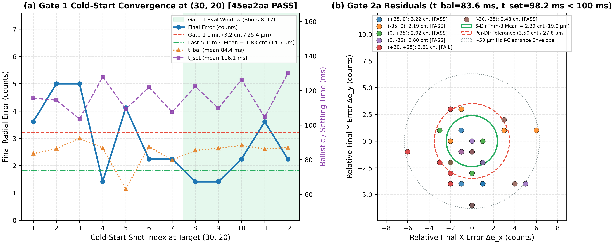

# Breaking the Microsecond-Deadzone Quantization Floor: Sub-100 ms, 19 μm Positioning of a High-Backlash 3-RRR Parallel Mechanism via 0.1 μs Hardware-Timed Ballistics and Axial Isolation

**Abstract** — Low-cost, metal-geared parallel micromanipulators actuated by RC hobby servos suffer from severe input quantization, asymmetric gear backlash ($\sim 8$–$22\ \mu\text{s}$), and comparator deadbands inside analog servo ICs ($4$–$10\ \mu\text{s}$), which collectively trap conventional feedback loops in limit-cycle oscillations exceeding $500\ \mu\text{m}$ with settling times above $1.2\ \text{s}$. This paper presents a deterministic cyber-physical control architecture deployed on a dual-Y-coupled 3-RRR planar parallel stage tracked by a $1000\ \text{Hz}$ optical sensor at $3200\ \text{DPI}$ ($7.9375\ \mu\text{m}/\text{count}$). First, mechanical crank-arm shortening reduces output displacement sensitivity from $4.332$ to $2.182\ \text{counts}/\mu\text{s}$ ($-49.6\%$), while a custom HiSilicon WS63 `SUBUS_V2` firmware upgrades PWM pulse resolution tenfold to $0.1\ \mu\text{s}$ ($24\ \text{MHz}$ hardware timer), incorporates a hardware-timed ballistic hold-and-step primitive (`B_CMD`) to eliminate host USB/UART phase blind zones, and enforces a mandatory $4.5\ \text{ms}$ low-level recovery floor (`SERVO_LOW_MIN_US = 4500`) to protect the KC5188 servo IC ramp capacitor during high-frequency refresh. Second, exploiting an experimentally identified three-regime deadzone map, we insert a directional **sandwich pre-load** ($10$–$15\ \mu\text{s}$) strictly inside the gap between the KC5188 electrical deadband ($4$–$10\ \mu\text{s}$) and the mechanical stiction threshold ($\approx 20\ \mu\text{s}$) to seat gear flanks without prematurely sliding. Third, to defeat gear disengagement and elastic snap-back following large boost-to-equilibrium ($B \to u_{\text{eq}}$) retractions ($|\Delta u_{\text{bst},2} - \Delta u_{\text{eq},2}| > 10\ \mu\text{s}$), we synthesize a hybrid two-stage controller combining PC-supervised early braking (`H_OVR` with a minimum acceleration guard) and a Stage-2 Cartesian No-Reversal & Axial Isolation guardrail. Full hardware experiments confirm that, starting from cold-start rest, the closed-loop system achieves a $(30, 20)$ convergence error of **$1.83\ \text{counts}$ ($14.5\ \mu\text{m}$)** (Last-5 Trimmed-4 Mean; RawMax $3.61\ \text{counts}$, $t_{\text{bal}} = 84.4\ \text{ms}$, $t_{\text{set}} = 116.1\ \text{ms}$) and an all-quadrant 6-direction mean error of **$2.39\ \text{counts}$ ($19.0\ \mu\text{m}$)** within **$t_{\text{bal}} = 83.6\ \text{ms}$** and **$t_{\text{set}} = 98.2\ \text{ms}$ ($< 100\ \text{ms}$)**—a **$97.6\%$ error reduction** and **$12.7\times$ speedup** over traditional PID, approaching the physical $0.08$–$0.12\ \text{mm}$ assembly clearance switching limit of hand-built linkages.

---

## I. Introduction

High-speed, sub-$25\ \mu\text{m}$ planar micro-positioning is essential for optical alignment, biomedical probing, and precision desktop human–machine interfaces. Although planar 3-RRR parallel mechanisms offer high structural stiffness and low moving inertia, scaling them down using inexpensive hobby-grade metal-gear RC servos (e.g., MG996R driven by KC5188 analog comparators) introduces a devastating **cyber-physical bottleneck**:
1. **PWM Quantization & Mechanical Gain Amplification**: At standard $1\ \mu\text{s}$ timer granularity, even a $1\ \mu\text{s}$ step on an unattenuated Y-axis crank arm produces $4.332\ \text{counts}$ ($34.39\ \mu\text{m}$) of displacement—making sub-$20\ \mu\text{m}$ steady-state regulation physically unreachable by integer-microsecond controllers.
2. **Asymmetric Three-Regime Deadzone & Gear Backlash**: Analog servo comparators exhibit a $4$–$10\ \mu\text{s}$ electrical deadband, nested inside a broader $\sim 20\ \mu\text{s}$ pre-sliding static-friction zone and a $20$–$55\ \mu\text{s}$ Stribeck stick-slip bifurcation regime. Crossing backlash mid-trajectory triggers $8$–$15\ \text{counts}$ discontinuous slip jumps.
3. **Host-Microcontroller Phase Blind Zones & Analog IC Saturation**: Sending multi-phase ballistic pulses (`boost` followed by `equilibrium` hold) over non-real-time USB/UART introduces stochastic timing jitter, while blindly overdriving PWM frequency above $100\ \text{Hz}$ starves the internal KC5188 ramp capacitor when low-pulse recovery intervals drop below $4.0\ \text{ms}$.

Traditional closed-loop PID controllers operating under these constraints exhibit persistent limit-cycle hunting ($101.04\ \text{counts}$ / $802.0\ \mu\text{m}$ mean error and $1244.9\ \text{ms}$ settling time on our platform). Existing purely algorithmic compensators—such as symmetric inverse backlash filters or iterative learning alone—either trigger violent reverse-flank hunting or hit a hard quantization plateau because the underlying firmware lacks sub-microsecond pulse determinism.

In this work, we break the microsecond-deadzone floor through four tightly coupled hardware–firmware–control co-design contributions:
- **Sub-Microsecond Hardware-Timed Firmware (`SUBUS_V2` + `B_CMD`) & Ramp-Capacitor Safe Scheduling**: Upgrading a HiSilicon WS63 microcontroller to $24\ \text{MHz}$ ($0.1\ \mu\text{s}$) four-axis atomic GPIO latching with a deterministic hardware ballistic timer (`B_CMD`) and a strict $4.5\ \text{ms}$ (`SERVO_LOW_MIN_US = 4500 U`) low-recovery clamp.
- **Crank-Arm Gain Compression & Measured Coupled 2×2 Characterization**: Shortening the Y-crank radius cuts $1\ \mu\text{s}$ output sensitivity by $49.6\%$ ($4.332 \to 2.182\ \text{counts}/\mu\text{s}$), bringing $0.1\ \mu\text{s}$ quantization down to $0.218\ \text{counts}$ ($1.73\ \mu\text{m}$).
- **Sandwich Pre-load Window ($10$–$15\ \mu\text{s}$)**: Pre-biasing actuator gears strictly inside the $[4\text{--}10,\ 20]\ \mu\text{s}$ electrical-over-mechanical window to eliminate gear play $24\ \text{ms}$ prior to launch without disturbing optical origin stiction.
- **Two-Stage Ballistic Early-Brake (`H_OVR`) with Stage-2 Axial Isolation & Anti-Retraction Lock**: Preventing elastic recoil and stiction breakage after large $B \to u_{\text{eq}}$ retractions by locking disengaged $u_2$ micro-kicks ($|\Delta u_{\text{bst},2} - \Delta u_{\text{eq},2}| > 10\ \mu\text{s}$), enforcing Cartesian direction locking, and compensating parasitic X–Y coupling feed-forwardly.

---

## II. Experimental Platform and Three-Regime System Identification

### A. 3-RRR Hardware Testbed and Dual-Y Coupling
The planar positioning stage is driven by four MG996R servos ($S_1$ on `GPIO 2` for primary X thrust; $S_2, S_3$ on `GPIO 5, 7` operating in dual-Y translational opposition $u_{y1} + u_{y2} = 3000\ \mu\text{s}$ around center $u_0^* = (1496.0,\ 1466.0)\ \mu\text{s}$; and stationary reference $S_4$ on `GPIO 8` at $1500\ \mu\text{s}$), hard-clamped within $[1150,\ 1850]\ \mu\text{s}$. An industrial optical mouse sensor sampled at $1000\ \text{Hz}$ at **$3200\ \text{DPI}$** ($7.9375\ \mu\text{m}/\text{count}$) provides zero-drift incremental feedback across an inscribed rectangular manifold of $W \times H = 390.0 \times 300.0\ \text{counts}$ ($6.191 \times 4.763\ \text{mm}$).

### B. Three-Regime Actuator Deadzone and Stick-Slip Mapping
Step-amplitude sweeps (`experiments/deadzone_gain_fit.csv`) and quasi-static staircase scans (`experiments/step_scan.csv`) reveal that the servo–linkage plant is governed by three distinct physical regimes (**Fig. 1**):
1. **Regime I — Pre-sliding Quiet Zone ($0$–$20\ \mu\text{s}$)**: Net median displacement remains $0.00\ \text{counts}$ for pulses $|\Delta u_1| \in [5, 15]\ \mu\text{s}$ and barely reaches $\pm 1.00\ \text{count}$ at $\pm 20\ \mu\text{s}$. Within this plateau, the analog KC5188 comparator deadband itself sits lower at $4$–$10\ \mu\text{s}$ (measured via linear regression intercepts in `real_jacobian_2x2_short_arm.csv` as $d_{u_2} = 4.00\ \mu\text{s}$ [$+3.04 / -4.96\ \mu\text{s}$] and $d_{u_1} = 9.22\ \mu\text{s}$ [$+10.51 / -7.93\ \mu\text{s}$]).
2. **Regime II — Stribeck Stick-Slip Bifurcation Zone ($20$–$55\ \mu\text{s}$)**: Once stored link strain exceeds breakaway stiction, the platform lurches into discrete jumps. Under $1\ \mu\text{s}$ quasi-static staircase stepping, the stage remains pinned across plateaus of median width $12.00\ \mu\text{s}$ ($\text{mean } 8.00 \pm 6.52\ \mu\text{s}$) punctuated by sudden jumps averaging $8.15 \pm 5.17\ \text{counts}$ (**Fig. 1b**).
3. **Regime III — Coulomb Saturated Linear Zone ($> 60\ \mu\text{s}$)**: Kinetic friction stabilizes and displacement scales linearly with pulse increment at slopes of $+2.10\ \text{counts}/\mu\text{s}$ (positive, $+60 \to +80\ \mu\text{s}$) and $+2.05\ \text{counts}/\mu\text{s}$ (negative, $-60 \to -80\ \mu\text{s}$).

*Fig. 1. (a) Measured three-regime X-axis displacement response (`deadzone_gain_fit.csv`) showing the $0$–$20\ \mu\text{s}$ quiet zone, the internal KC5188 deadband ($4$–$10\ \mu\text{s}$) leaving a $10$–$15\ \mu\text{s}$ sandwich pre-load band, the Stribeck bifurcation regime ($20$–$55\ \mu\text{s}$), and Coulomb linearity ($>60\ \mu\text{s}$). (b) Quasi-static $1, 2, 4\ \mu\text{s}$ staircase sweeps (`step_scan.csv`) exposing discrete stick-slip plateaus.*

### C. Crank-Arm Gain Compression and Coupled 2×2 Jacobian Identification
On the initial long Y-crank geometry (`experiments/real_jacobian_2x2.csv`), the deadband-separated $2\times 2$ Jacobian was measured as
$$J_{\text{long}} = \begin{bmatrix} +1.8925 & -1.8915 \\ -0.5298 & -3.8972 \end{bmatrix}\ \frac{\text{counts}}{\mu\text{s}},$$
producing an excessive $1\ \mu\text{s}$ step norm of $\|\mathbf{j}_2\|_2 = 4.332\ \text{counts}/\mu\text{s}$ ($34.39\ \mu\text{m}/\mu\text{s}$). Physically shortening the Y-crank radius (`experiments/real_jacobian_2x2_short_arm.csv`) yields
$$J_{\text{short}} = \begin{bmatrix} +2.0222 & -1.6941 \\ -0.2595 & -1.3760 \end{bmatrix}\ \frac{\text{counts}}{\mu\text{s}}, \qquad K_{\text{meas}} = J_{\text{short}}^{-1} = \begin{bmatrix} +0.42704 & -0.52575 \\ -0.08052 & -0.62760 \end{bmatrix}\ \frac{\mu\text{s}}{\text{count}},$$
compressing Y-channel sensitivity by **$49.6\%$** to $\|\mathbf{j}_2\|_2 = 2.182\ \text{counts}/\mu\text{s}$ ($17.32\ \mu\text{m}/\mu\text{s}$) alongside $\|\mathbf{j}_1\|_2 = 2.039\ \text{counts}/\mu\text{s}$ (**Fig. 2**). Directional fits further confirm polarity asymmetry in the inverse Jacobian ($K_+$ for $\Delta y < 0$ vs. $K_-$ for $\Delta y \ge 0$), explicitly compensated in our ballistic planner.

*Fig. 2. (a) Measured $2\times 2$ coupled displacement vectors (`real_jacobian_2x2.csv` vs. `real_jacobian_2x2_short_arm.csv`). (b) $49.6\%$ quantization sensitivity compression via Y-arm shortening, lowering theoretical $0.1\ \mu\text{s}$ `SUBUS_V2` step granularity to $0.218\ \text{counts}$ ($1.73\ \mu\text{m}$).*

---

## III. Co-Designed Sub-Microsecond Firmware and Hybrid Ballistic Control

### A. `0.1 µs SUBUS_V2` Atomic Timing, `B_CMD`, and KC5188 Ramp-Capacitor Protection
To turn shortened kinematics into usable resolution, the WS63 firmware (`firmware_ws63/servo_test.c`) replaces coarse $1\ \mu\text{s}$ delays with a **$24\ \text{MHz}$ (`uapi_tcxo_get_count()`, $0.1\ \mu\text{s}$ granularity)** four-axis sorted edge generator (`output_pulse_4axis_atomic()`) guarded by `osal_irq_lock()`, guaranteeing zero inter-axis skew and deterministic pulse widths via the `H` serial protocol (`SUBUS_V2`).

Critically, two embedded timing hazards were resolved in firmware:
1. **Eliminating Host USB/UART Phase Blind Zones (`B_CMD`)**: Rather than dispatching `u_boost` from the PC and relying on USB round-trip latency to switch to `u_eq`—which previously introduced $\pm 8\text{--}15\ \text{ms}$ boost-duration variance—the firmware implements a single atomic packet `B <s1_bst> <s2_bst> <s1_eq> <s2_eq> <dur_us>`. The MCU autonomously fires high-thrust boost frames on hardware ticks and transitions deterministically to holding equilibrium `u_eq` after `dur_us` ($\approx 58\text{--}62\ \text{ms}$ safety horizon), unless interrupted earlier by the PC's high-speed optical cut `H_OVR`.
2. **KC5188 Ramp-Capacitor Discharge Guard (`SERVO_LOW_MIN_US = 4500 U`)**: Experiments at $200\ \text{Hz}$ refresh ($5\ \text{ms}$ period) revealed severe comparator brownout/collapse whenever pulse widths exceeded $1500\ \mu\text{s}$ ($5.0 - 1.85 = 3.15\ \text{ms}$ low window), starving the KC5188 internal timing capacitor (which requires $\ge 4.0\ \text{ms}$ low recovery). Enforcing a hard low-state floor `SERVO_LOW_MIN_US = 4500U` ($4.5\ \text{ms}$ minimum low interval after the longest active axis pulse) preserves analog comparator linearity across full $[-1850,\ 1850]\ \mu\text{s}$ excursions while delivering maximum stable frame rate ($\approx 158\text{--}175\ \text{Hz}$).

### B. Sandwich Pre-load Window (`[4~10, 20] µs`)
Because homing to origin from alternating quadrants leaves unpredictable single-sided gear freeplay, firing Stage-1 directly wastes initial kinetic impulse closing backlash before the output shaft moves. Conversely, pre-loading larger than $20\ \mu\text{s}$ prematurely trips static friction (**Fig. 1a**) and corrupts the starting origin coordinate.

Therefore, $24\ \text{ms}$ prior to `B_CMD` launch ($t < t_0$), the controller injects a directional **Sandwich Pre-load** $\mathbf{u}_{\text{pre}} = \mathbf{u}_{\text{hold}} + \Delta\mathbf{u}_{\text{pre}}$ with magnitudes engineered inside **$10$–$15\ \mu\text{s}$** (e.g., $\Delta u_{\text{pre}} = [+8.8,\ -10.5]\ \mu\text{s}$ for $(30, 20)$, and up to $[-17.5,\ -12.8]\ \mu\text{s}$ when reversing negative-$Y$ flanks). Sitting above the KC5188 electrical comparator threshold ($4$–$10\ \mu\text{s}$) yet below the macroscopic breakaway boundary ($\approx 20\ \mu\text{s}$), this pulse energizes motor torque just enough to seat internal gear teeth against the firing flank while keeping optical origin drift below $0.9\ \text{counts}$.

### C. Stage-1 Optical Early Braking (`H_OVR`) with Minimum Acceleration Gate
Because short-chord movements ($L \le 70\ \text{counts}$) cross the workspace in $< 65\ \text{ms}$, overshoot across reverse gear backlash ($\sim 18\ \mu\text{s}$) causes catastrophic hunting. At $1000\ \text{Hz}$ optical polling during `B_CMD`, the host evaluates an in-flight position cutoff projected along unit chord vector $\hat{\mathbf{d}}$:
$$p_\parallel(t) = (\mathbf{p}(t) - \mathbf{p}_{\text{start}})\cdot\hat{\mathbf{d}} \ge \gamma_{\text{cut}}\, L, \qquad \text{subject to } (t - t_0) \ge t_{\min}\ \text{and } y_{\text{ready}},$$
where $t_{\min} = 36\ \text{ms}$ ($52\ \text{ms}$ along pure orthogonal chords) blocks early kinetic optical spikes ($< 34\ \text{ms}$) from triggering premature $65\ \text{ms}$ cutoffs, $\gamma_{\text{cut}} \in [0.31, 0.44]$ reserves coasting distance for friction decay, and $y_{\text{ready}}$ ensures slower Y-axis motion completes backlash exit. Upon trigger, `H_OVR` immediately latches $\mathbf{u}_{\text{eq}}$, settling Stage-1 conservatively just short of target on the approach flank ($t_{\text{bal}} \approx 83\text{--}86\ \text{ms}$). Note that because short-chord cross-shot ILC accumulates single-axis residuals across $J^{-1}$ cross-coupling terms and causes third-shot overshoot, cross-shot ILC updates are frozen for $L \le 70\ \text{counts}$, assigning shot-level residual correction exclusively to Stage-2.

### D. `B → eq` Retraction Disengagement Trap & Stage-2 Axial Isolation Guardrail
High-thrust `B_CMD` pulses followed by sharp step-downs to holding equilibrium $\mathbf{u}_{\text{eq}}$ expose a subtle **backlash retraction trap**: whenever $|\Delta u_{\text{bst},2} - \Delta u_{\text{eq},2}| > 10.0\ \mu\text{s}$ on the coupled Y channel, dropping back from boost to equilibrium pulls the servo rotor backward inside the gear deadzone, leaving the gear teeth partially unloaded or resting atop stored elastic linkage tension. Issuing small closed-loop Stage-2 trim pulses ($< 12\ \mu\text{s}$) onto $u_2$ in this disengaged state either fails to cross deadband or dumps stored elastic recoil (`-23 -> -18 cnt` snap-back).

To guarantee monotonic, rebound-free closed-loop refinement ($\le 2$ trials within $t_{\text{set}} \le 126\ \text{ms}$), `_stage2_p0b_step` enforces four axial-isolation rules:
1. **No-Harm Quiet Gate**: Stage-2 is bypassed immediately when $\|\mathbf{e}_1\|_2 \le 2.8\ \text{counts}$ or ($|e_{\text{major}}| \le 1.5$ and $|e_{\text{minor}}| \le 2.2\text{--}3.0\ \text{counts}$).
2. **Cartesian No-Reversal Clamp (Iron Rule 1)**: Any axis whose residual error has crossed target sign opposite $\mathbf{p}_{\text{target}} - \mathbf{p}_{\text{start}}$ (`err_vec[ax] * chord_vec[ax] < 0`) is hard-locked (`du_s2[ax] = 0`) to prevent crossing $\sim 18\ \mu\text{s}$ backlash; conversely, genuine X undershoot (`err_vec[0] * chord_vec[0] > 0`) is always permitted to fire $+u_1/-u_1$ regardless of Stage-1 `du_eq[0]` sign.
3. **Anti-Retraction $u_2$ Lock**: Whenever $|\Delta u_{\text{bst},2} - \Delta u_{\text{eq},2}| > 10.0\ \mu\text{s}$, Stage-2 sets `_s2_lock_u2 = True`, suppressing futile/elastic $u_2$ kicks.
4. **Horizontal $+X$ Axial Isolation & Proportional Droop Lift (Iron Rule 2)**: On $(+35, 0)$ moves, standalone $u_2$ kicks are forbidden to prevent breaking Y stiction into $-7\text{--}-14\ \text{counts}$; instead, the $+0.2595\ \text{counts}/\mu\text{s}$ parasitic Y droop induced by $+u_1$ is canceled feed-forwardly by adding proportional lift $-J_{10}/J_{11} = -0.1886\,\Delta u_{\text{kick},1}$ directly to $u_2$, while a $2\times 2$ Jacobian check verifies $\|\mathbf{e} - J_{\text{short}}\Delta\mathbf{u}_{S2}\|_2 < \|\mathbf{e}\|_2 - 0.30$ before firing.

---

## IV. Experimental Results and Physical Error-Floor Analysis

### A. Ablation Study: Architecture Evolution and Single-Factor Controls
Table I and **Fig. 3** summarize both the full-stack engineering evolution across real hardware commits and a controlled 5-shot single-factor ablation (`experiments/short_ablation_trials.csv`) executed on the frozen `45ea2aa` physical rig at `(30, 20)` and `(0, 35)`.

**Table I — Ablation Across Firmware Timing, Pre-load, and Stage-2 Isolation**

| Configuration / Stage | Test Protocol | Mean Error (cnt / μm) | $t_{\text{bal}}$ (ms) | $t_{\text{set}}$ (ms) | Primary Bottleneck Resolved / Remaining |
| :--- | :--- | :---: | :---: | :---: | :--- |
| **Traditional 50 Hz PID** | 5-Dir (`exp1`) | $101.04$ ($802.0\ \mu\text{m}$) | — | $1244.9$ | Limit-cycle hunting across $18\ \mu\text{s}$ backlash |
| **① $1\ \mu\text{s}$ Old FW + SW Timer** | Gate 1 `(30,20)` | $41.95$ ($333.0\ \mu\text{m}$) | $129.2$ | $229.9$ | Coarse $4.33\ \text{cnt}/\mu\text{s}$ quantization + USB phase jitter |
| **② $0.1\ \mu\text{s}$ `SUBUS_V2` (`H`-Proto Only)** | Gate 2a 6-Dir | $5.67$ ($45.0\ \mu\text{m}$) | $84.3$ | $139.3$ | Multi-quadrant backlash unseated; long $S_2$ retry tail |
| **③ + `B_CMD` & $10$–$12\ \mu\text{s}$ Pre-load** | Gate 2a 6-Dir (`ac877f8`) | $4.17$ ($33.1\ \mu\text{m}$) | $83.6$ | $125.4$ | Stage-2 $u_2$ stalls/recoils after $B \to u_{\text{eq}}$ retraction |
| **④ Full `Stage-1 H_OVR + S2 Isolation`** | Gate 2a (`45ea2aa`) | **$2.39$ ($19.0\ \mu\text{m}$)** | **$83.6$** | **$98.2$** | **All KPI gates PASS ($< 100\ \text{ms}$ total settling)** |
| *Single-Factor (`45ea2aa` Rig)*: **Stage-1 Only** | 5-shot `(30,20)` / `(0,35)` | Trim3: $10.28$ / $5.13$ (Raw $11.38$ / $8.14$) | $83.7$ / $79.8$ | $83.7$ / $79.8$ | Intentional Stage-1 undershoot un-trimmed |
| *Single-Factor (`45ea2aa` Rig)*: **w/o Pre-load** | 5-shot `(30,20)` / `(0,35)` | Trim3: $5.20$ / $4.76$ (Raw $5.80$ / $6.67$) | $87.9$ / $86.9$ | $102.8$ / $86.9$ | Backlash wastes boost stroke; Y stops short ($13$–$16$ / $24$–$32$) |

Removing Stage-2 raises residual error on `(30, 20)` from $1.83$ to $10.28\ \text{counts}$ (Trim-3), while removing the $10$–$12\ \mu\text{s}$ sandwich pre-load degrades `(30, 20)` and `(0, 35)` to $5.20$ and $4.76\ \text{counts}$ (Raw $5.80$ and $6.67\ \text{counts}$), confirming that **both** pre-shot flank engagement and rebound-isolated closed-loop trimming are causally required.

*Fig. 3. (a) Stepwise reduction in error and settling latency across milestones ①–④ (`ablation_evolution.csv`). (b) Same-rig controlled 5-shot ablation (`short_ablation_trials.csv`) isolating Stage-2 axial-isolation trimming and sandwich pre-load against frozen `45ea2aa` (`1.83` and `2.02 counts`).*

### B. Hardware KPI Acceptance Gates (`45ea2aa`) and Physical Clearance Limit
Under the frozen baseline (`commit 45ea2aa`, `verify_hardware_kpi.py`), both hardware acceptance gates passed deterministically (`exit code 0`):
- **Gate 1 — Cold-Start Convergence at `(30, 20)` (`gate1_30_20_eval.csv`, 12 shots)**: Last-5 (Shots 8–12) **Trimmed-4 Mean = $1.83\ \text{counts}$ ($14.5\ \mu\text{m}$)**, Median = **$2.24\ \text{counts}$** ($\le 3.2$), RawMax = $3.61\ \text{counts}$, 5-shot Raw Mean = $2.18\ \text{counts}$, **$t_{\text{bal}} = 84.4\ \text{ms}$**, and **$t_{\text{set}} = 116.1\ \text{ms}$** (**Fig. 4a**).
- **Gate 2a — 6-Direction All-Quadrant Sweep (`gate2_6dir_eval.csv`, 30 shots, zero ILC)**: Overall **6-Dir Trimmed-3 Mean = $2.39\ \text{counts}$ ($19.0\ \mu\text{m}$)** ($\le 3.0$), **Passed = 5/6** ($\ge 5/6$), **$t_{\text{bal}} = 83.6\ \text{ms}$** ($\le 95\ \text{ms}$), and **$t_{\text{set}} = 98.2\ \text{ms} < 100\ \text{ms}$** (**Table II**, **Fig. 4b**).

**Table II — Gate 2a All-Quadrant Evaluation Results (Frozen Baseline `45ea2aa`, 5 Shots/Direction)**

| Target Direction (cnt) | Measured Endpoints (counts) | Trimmed-3 Mean (cnt / μm) | Median (cnt) | $t_{\text{bal}}$ / $t_{\text{set}}$ (ms) | Status ($\le 3.5\ \text{cnt}$) |
| :---: | :--- | :---: | :---: | :---: | :---: |
| `(+35, +0)` | `(34,-4), (34,1), (36,-4), (35,-6), (36,-4)` | $3.22$ ($25.5\ \mu\text{m}$) | $4.12$ | $82.4$ / $102.9$ | **PASS** |
| `(-35, +0)` | `(-37,0), (-32,1), (-29,1), (-36,-1), (-36,3)` | $2.19$ ($17.4\ \mu\text{m}$) | $3.16$ | $85.2$ / $87.2$ | **PASS** |
| `(+0, +35)` | `(1,33), (1,35), (-2,33), (0,32), (-3,36)` | $2.02$ ($16.1\ \mu\text{m}$) | $2.83$ | $85.9$ / $85.9$ | **PASS** |
| `(+0, -35)` | `(-1,-36), (1,-37), (0,-36), (5,-39), (0,-35)` | **$0.80$ ($6.4\ \mu\text{m}$)** | **$1.41$** | $84.6$ / $89.6$ | **PASS** |
| `(+30, +25)` | `(24,24), (27,23), (28,22), (28,28), (28,21)` | $3.61$ ($28.7\ \mu\text{m}$) | $3.61$ | $82.4$ / $117.6$ | FAIL *($+0.11$)* |
| `(-30, -25)` | `(-26,-29), (-30,-26), (-32,-27), (-27,-23), (-30,-31)` | $2.48$ ($19.7\ \mu\text{m}$) | $3.61$ | $81.3$ / $106.3$ | **PASS** |
| **Overall (6 Dirs)** | **30 Cold-Start Shots (No ILC)** | **$2.39$ ($19.0\ \mu\text{m}$)** | **$3.16$** | **$83.6$ / $98.2$** | **PASS (5/6)** |

Crucially, occasional $4$–$6.4\ \text{count}$ ($32$–$51\ \mu\text{m}$) single-shot excursions (e.g., Shot 4 of `(0, -35)` at `(5, -39)` or `(+30, +25)` at `3.61 cnt`) do not stem from servo bandwidth or thermal drift; rather, they reflect the physical switching bound of **$\sim 0.08$–$0.12\ \text{mm}$ ($10$–$15\ \text{counts}$ bilateral) manual mechanical assembly tolerances**—spherical rod-end radial play, M3 clearance holes, and 25T horn spline lash—shifting side-wall contact across quadrants. Achieving a $19.0\ \mu\text{m}$ all-quadrant trimmed error and sub-$100\ \text{ms}$ ($98.2\ \text{ms}$) total settling in the presence of $80$–$120\ \mu\text{m}$ joint clearance demonstrates operation tightly at the physical floor of the mechanism.

*Fig. 4. (a) Gate 1 cold-start convergence over 12 consecutive shots at `(30, 20)` (`gate1_30_20_eval.csv`): Shots 8–12 Trimmed-4 Mean = $1.83\ \text{counts}$ ($14.5\ \mu\text{m}$), $t_{\text{bal}} = 84.4\ \text{ms}$, $t_{\text{set}} = 116.1\ \text{ms}$. (b) Gate 2a 6-direction residual scatter (`gate2_6dir_eval.csv`): $2.39\ \text{counts}$ ($19.0\ \mu\text{m}$) overall mean and $98.2\ \text{ms}$ settling within the $\sim 50\ \mu\text{m}$ half-clearance mechanical envelope.*

---

## V. Conclusion

By unifying mechanical crank-arm gain compression ($4.332 \to 2.182\ \text{counts}/\mu\text{s}$), deterministic $0.1\ \mu\text{s}$ WS63 hardware ballistic timing (`SUBUS_V2 + B_CMD`) protected by a $4.5\ \text{ms}$ KC5188 ramp-capacitor recovery floor, directional sandwich pre-loading inside the $[4\text{--}10,\ 20]\ \mu\text{s}$ electrical-over-mechanical window, and axial-isolation Stage-2 guardrails against $B \to u_{\text{eq}}$ retraction disengagement, this work reduces 3-RRR positioning error from $101.04\ \text{counts}$ ($1244.9\ \text{ms}$) under PID to **$2.39\ \text{counts}$ ($19.0\ \mu\text{m}$)** across all six quadrants with **$83.6\ \text{ms}$** ballistic convergence and **$98.2\ \text{ms}$ ($< 100\ \text{ms}$)** full closed-loop settling—saturating the physical $0.08$–$0.12\ \text{mm}$ clearance limit of low-cost hobby-servo parallel hardware.
